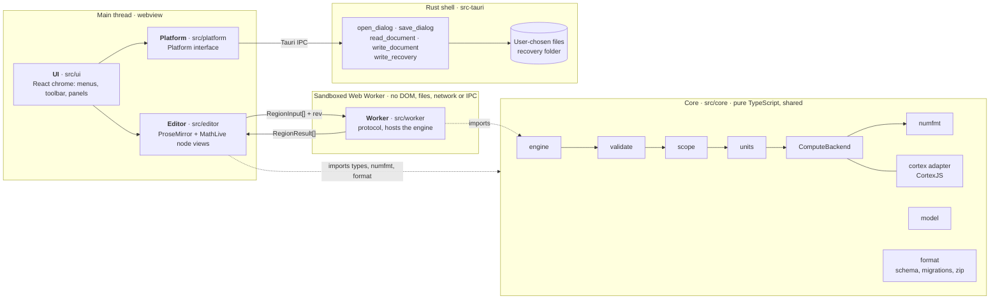

# Radium Math — Architecture

Nov 9, 2026 · @Isaiah Ware

Radium Math is a React + ProseMirror editor in a Tauri shell, with all calculation running in a sandboxed Web Worker that receives only validated math trees. This doc implements the v1 Requirements; requirement IDs (e.g. SEC-03) refer to that doc.

## 1. At a glance



Solid arrows are runtime calls and messages; dotted arrows are imports. Core runs wherever it is imported: the engine pipeline runs inside the worker, while the editor uses core's types, number formatting and file format on the main thread.

The editor sends region inputs to the worker and draws the results it gets back; only the Platform layer talks to Rust, and only Rust touches files.

## 2. Layers and responsibilities

Six layers, with dependencies pointing only toward `core`; `core` is pure TypeScript with no DOM, React, ProseMirror or Tauri imports (MNT-02, PLT-02).

| Layer | Folder | Owns | May import |
| --- | --- | --- | --- |
| Core | `src/core` | Region input types, validator, scope resolver, units, number formatting, `ComputeBackend` interface, engine orchestration, file schema and migrations | Nothing outside `core` (plus CortexJS in `core/compute/cortex` only) |
| Worker | `src/worker` | Web Worker entry: hosts the engine, speaks the worker protocol | `core` |
| Editor | `src/editor` | ProseMirror schema, plugins, node views, Markdown input rules, extraction of region inputs from the doc | `core` (types and format only) |
| UI | `src/ui` | React app chrome: menus, toolbar, side panels (checks summary, symbol inspector), dialogs | `editor`, `platform`, `core` types |
| Platform | `src/platform` | `Platform` interface (open, save, autosave, export paths) and its Tauri implementation | `@tauri-apps/api` only |
| Shell | `src-tauri` | Rust: window, CSP, capabilities, file dialogs, atomic file write | Tauri crates |

The rules are enforced in CI by dependency-cruiser, so a wrong-direction import fails the build.

## 3. Repository layout

One package (no monorepo tooling); folders mirror the layers.

```text
radium-math/
  CLAUDE.md                 conventions and rules for every session
  LICENSE                   MIT
  docs/
    requirements.md
    architecture.md
    adr/                    0001-tauri-shell.md, 0002-cortexjs.md, ...
  src/
    core/
      model/                RegionInput, ids, schema version
      validate/             MathJSON allow-list (SEC-02, SEC-05)
      scope/                top-to-bottom symbol table
      units/                dimensions, unit registry, conversion
      numfmt/               number formatting
      compute/
        backend.ts          ComputeBackend interface
        cortex/             CortexJS adapter (only place CortexJS is imported)
      engine/               pipeline orchestration, recalculation
      format/               file schema, migrations, zip container
    worker/                 worker entry + protocol
    editor/                 schema, plugins, node views, markdown rules
    ui/                     React components
    platform/               Platform interface + Tauri implementation
    main.tsx
  src-tauri/                Rust shell
  tests/
    golden/                 reference documents + expected results (MNT-07, ACC-02)
    malicious/              hostile files for SEC tests
    e2e/                    Playwright UI tests
```

## 4. Core interfaces

These types are the contract between layers; everything else is an implementation detail behind them. They are first drafts to be refined in M1.

**Region inputs** (editor → engine). The editor splits `name := expr` into its parts, so the engine never parses left-hand sides.

```typescript
type BlockId = string;                       // UUID, stable for the block's life (FIL-04)
type MathJson = unknown;                     // raw MathLive output, untrusted until validated

type RegionInput =
  | { kind: "definition"; id: BlockId; name: string; params?: string[]; expr: MathJson; display?: DisplaySpec }
  | { kind: "evaluation"; id: BlockId; expr: MathJson; display?: DisplaySpec }
  | { kind: "symbolic";   id: BlockId; op: SymbolicOp; expr: MathJson; wrt?: string }
  | { kind: "check";      id: BlockId; expr: MathJson };

type SymbolicOp = "simplify" | "expand" | "factor" | "differentiate" | "integrate" | "solve";

interface DisplaySpec {
  unit?: MathJson;          // UNT-03, e.g. MPa
  format?: NumberFormat;    // MTH-11 override
  showWork?: boolean;       // MTH-10
}
```

**Quantities** (inside the engine). Values are stored in coherent SI; dimensions are exponent vectors over the 7 SI base dimensions, with rational exponents so sqrt(m²) works.

```typescript
interface Rational { readonly num: bigint; readonly den: bigint }   // always reduced, den > 0
type Dimension = readonly [Rational, Rational, Rational, Rational, Rational, Rational, Rational];
//                         L         M         T         I         Θ         N         J

interface Quantity { readonly si: number; readonly dim: Dimension }
```

**Compute backend** (engine → CAS). Takes only validated trees and plain numbers; it knows nothing about units.

```typescript
interface ComputeBackend {
  evaluate(expr: ValidExpr, env: ReadonlyMap<string, number>): number | ComputeError;
  symbolic(op: SymbolicOp, expr: ValidExpr, wrt?: string): ValidExpr | ComputeError;
}
// ValidExpr is a branded type: the only way to get one is through core/validate.
```

**Results** (engine → editor).

```typescript
type RegionResult =
  | { id: BlockId; status: "ok"; value: FormattedValue; work?: WorkStep[]; pass?: boolean }
  | { id: BlockId; status: "error"; error: { code: ErrorCode; message: string } }
  | { id: BlockId; status: "blocked"; blockedBy: BlockId };          // MTH-12

type ErrorCode = "undefined-symbol" | "defined-below" | "dimension-mismatch" | "bad-display-unit"
               | "disallowed" | "too-large" | "unsupported" | "timeout" | "internal";
```

**Worker protocol.** The UI always sends the full region list with a document revision number; the worker diffs against its cache, and the UI drops any result whose revision is stale.

```typescript
type ToWorker   = { type: "evaluate"; rev: number; settings: DocSettings; regions: RegionInput[] };
type FromWorker = { type: "ready" } | { type: "results"; rev: number; results: RegionResult[] };
```

Vectors and matrices (MTH-15) widen `Quantity.si` to `number | Matrix` in a later milestone; the interfaces above are kept narrow until then.

## 5. Evaluation engine

The engine walks regions once, top to bottom, and recomputes a region only when its own input or a definition it reads has changed; this gives correct results and incremental recalculation (MTH-04, MTH-06, MTH-07) from one mechanism.

**Per-region pipeline (numeric):**

1. **Validate:** check the MathJSON tree against the allow-list and size/depth limits, producing a `ValidExpr` or an error.
2. **Resolve:** look up every free name in the scope built so far. A name defined only below gives `defined-below`; an unknown name gives `undefined-symbol`.
3. **Dimension check:** the units layer infers the result dimension from the tree and the operand dimensions (Section 6). A mismatch here is an error before any arithmetic runs.
4. **Scale:** unit literals in the tree are replaced by their SI factors (3.4 in becomes 3.4 × 0.0254), so the backend sees plain numbers.
5. **Compute:** `ComputeBackend.evaluate` returns the SI magnitude.
6. **Format:** convert to the display unit or document default, apply number format, and build show-work steps if enabled.

**Scope.** The scope is an ordered map from name to the most recent definition above the current region. A function definition stores its validated body and parameter names; its result dimension is inferred at each call site from the argument dimensions.

**Change detection.** Each region caches a key: its input hash plus the output hashes of every definition it read. On a new region list the engine walks top to bottom and recomputes only regions whose key changed. A typical edit recomputes a handful of regions, not the document.

**Errors.** A failed definition still enters the scope, marked failed. Any later region that reads it returns `blocked` with `blockedBy`, so stale values are never shown (MTH-12).

**Timeouts.** Before each region the worker posts a short "starting region X" message. If results do not arrive within the time limit, the UI-side worker host terminates the worker, marks region X `timeout`, starts a fresh worker, and resends with X skipped (SEC-04).

**Symbolic and check regions** share steps 1–3. A symbolic region substitutes every name defined above as its SI value times SI base-unit symbols (A1, A2), then calls `ComputeBackend.symbolic`; base-unit symbols in the result render upright as units, and a fully numeric result goes through normal display conversion. A check region evaluates a comparison and reports `pass`.

## 6. Units layer

Every quantity is held as an SI magnitude plus a dimension vector, so mixed compatible units combine with no special handling: 2 m × 3.4 in becomes 2 × 0.08636 = 0.17272 with dimension L², displayed as 0.17272 m² (UNT-10).

**Unit registry.** Each unit is a record: name, symbols, dimension, SI factor as an exact `Rational` where the definition is exact (1 in = 127/5000 m; 1 lbm = 0.45359237 kg; UNT-08), an optional offset, and whether SI prefixes apply. Derived units are defined from others (psi = lbf/in²), so exactness carries through. Factors are reduced to a double only at the last step.

**Dimension rules.**

| Operation | Rule |
| --- | --- |
| a + b, a − b, comparisons, min, max | Dimensions must be equal; result has that dimension |
| a × b, a ÷ b | Exponents add or subtract |
| aⁿ | If a has a dimension, n must be a constant rational; exponents multiply by n |
| √a, ⁿ√a | Exponents divide by the root index |
| sin, cos, tan, exp, ln, log, hyperbolics | Argument must be dimensionless; result dimensionless |
| abs, floor, ceil, round | Result keeps the argument's dimension |
| f(x, …) user function | Body's dimension inferred with the argument dimensions substituted |

Angles: radian is dimensionless and degree is a unit with factor π/180, so sin(30°) works with no special case (UNT-07).

**Offset temperatures (UNT-06).** °C and °F literals carry a flag: absolute temperature. Δ°C and Δ°F are ordinary units (factor 1 and 5/9, no offset). The rules:

- absolute − absolute gives a difference; absolute + difference gives absolute;
- absolute + absolute is an error;
- in ×, ÷ or a power, an absolute temperature is first converted to kelvin, so p = ρRT works with T in °C;
- an absolute result can be displayed in °C or °F (offset applied); a difference displays in Δ°C, Δ°F or K.

K and °R carry no flag and work everywhere.

**Default display (UNT-04).** Each unit system has a preferred-unit table keyed by dimension: SI uses the named coherent unit where one exists (N, Pa, J, W) and base units otherwise; US customary maps, for example, length to in, force to lbf, stress to psi. A dimension with no entry displays as a product of the system's base units.

## 7. Editor

The ProseMirror document is the single source of truth for content; React draws the app around it but never holds document state.

**Schema (v1).**

| Node | Kind | Key attributes |
| --- | --- | --- |
| `heading` | block | `id`, `level` 1–4 |
| `paragraph` | block | `id` |
| `bullet_list`, `ordered_list`, `list_item` | block | `id` |
| `math_region` | block, atom | `id`, `kind`, `name`, `params`, `expr` (MathJSON), `display`, `op` |
| `image` | block, atom | `id`, `asset` (file entry), `caption`, `width`, `align` |
| `page_break` | block, atom | `id` |
| `inline_math` | inline, atom | `latex` (display only, TXT-03) |
| `value_ref` | inline, atom | `name` (live value, TXT-04) |

Marks: bold, italic, underline, subscript, superscript, code, link.

**Math regions.** A ProseMirror node view hosts a MathLive `<math-field>` web component directly, not through React, to keep typing fast (PRF-03). On change, the node view writes the field's MathJSON into the node's attributes as one transaction, so undo and redo cover math edits (EDT-03). Results render in a separate decoration under the field.

**Unit entry (A3).** Units never share a namespace with variables. A space typed right after a number or a closing parenthesis opens a unit slot; the slot accepts only unit names and the operators ·, / and ^, with autocomplete from the unit registry, and Enter or Tab closes it. An "Insert unit" toolbar button does the same. Units render upright, variables italic. In MathJSON a quantity is stored as `["Quantity", value, unitExpr]`, a node the validator accepts only with a registry unit expression; an unknown name is flagged with a suggestion. Pasted text such as `3.4 in` becomes a quantity when the unit is recognized. If MathLive cannot support the space trigger cleanly, the fallback is a dedicated key such as `'`.

**Engine link.** A ProseMirror plugin watches transactions. After a short pause in typing it extracts the region list in document order and posts it to the worker with the current revision; returned results are stored in plugin state and drawn as decorations, never written into the document (FIL-03).

**Markdown (TXT-05).** Input rules convert typed syntax as you type (` ##  ` becomes a heading, `**x**` becomes bold, ` -  ` starts a list). Pasted Markdown is parsed with prosemirror-markdown into the same schema, and anything outside the schema is dropped (SEC-12).

**React's role.** React renders menus, toolbar, side panels, dialogs and the host component that mounts the ProseMirror view. UI-only state (panel open, zoom) lives in a small store (zustand).

## 8. Security boundary and Tauri shell

Untrusted bytes cross into the app at exactly three points: opening a file, pasting, and importing an image. Each has one validator, and nothing downstream of it trusts raw input.

| Threat | Control | Req |
| --- | --- | --- |
| Math content turned into code | Allow-list validator; the CortexJS adapter never calls `compile()` (which generates JavaScript) and never parses LaTeX strings, only validated MathJSON; Cortex program operators (assignment, loops, declarations) are not on the allow-list; lint rule bans `eval` and `Function` everywhere | SEC-01, SEC-02 |
| Runaway computation | Worker watchdog with terminate-and-restart (Section 5); size and depth limits in the validator | SEC-04, SEC-05 |
| Compute escapes to files or network | Worker gets no Tauri IPC handle (checked by a test in M1); CSP restricts the network; Tauri capabilities expose no file or shell API to scripts | SEC-03, SEC-07 |
| Malicious file | Zip limits (entry count, total and per-entry size, no path traversal); JSON validated with zod before a ProseMirror doc is built | SEC-10, SEC-11 |
| Malicious SVG | Shown only through `` from a blob URL, where scripts and external loads do not run; sanitized with DOMPurify before export | SEC-06, SEC-13 |
| Hostile paste | Paste parsed into the schema; unknown nodes and attributes dropped | SEC-12 |

**Content Security Policy.** `default-src 'self'`; `script-src 'self'`; `object-src 'none'`; `base-uri 'none'`; `img-src 'self' blob: data:`; `connect-src` limited to Tauri's IPC origin. MathLive may need `style-src 'unsafe-inline'`; that is checked in M2 and recorded in an ADR if required.

**Rust shell.** Kept to five commands, and no shell, http or updater plugins (SEC-09):

- `open_dialog` and `save_dialog` (tauri-plugin-dialog). Each returned path is added to a per-session allow-list held in Rust.
- `read_document(path)` returns the file's bytes, only for allow-listed paths.
- `write_document(path, bytes)` writes to a temp file in the same folder, flushes it, then renames it over the target, only for allow-listed paths (REL-01).
- `write_recovery(bytes)` writes autosave data to the app's own data folder (EDT-05).

The TypeScript side reaches these only through the `Platform` interface, so core and editor tests run in Node with a fake platform.

## 9. File format and persistence

A document is a zip with a fixed layout, written deterministically so that the same document always produces the same bytes (FIL-01, FIL-05).

```text
example.rmath (zip)
  manifest.json      { "format": "radium-math", "schemaVersion": 1, "appVersion": "0.1.0" }
  document.json      { meta, settings, theme, pageSetup, content }   content = ProseMirror JSON
  assets/
    <sha256>.png     images named by content hash: duplicates stored once
```

- **Determinism.** JSON written with sorted keys and fixed indentation; zip entries in fixed order with fixed timestamps.
- **No results stored.** Only inputs are saved; every result is recomputed on open (FIL-03).
- **Versioning.** Each schema change adds one pure migration function `vN → vN+1` with its own golden test. Opening runs the chain up to the current version; a newer version than the app knows is refused with a message naming the required app version (FIL-02).
- **Load order.** Unzip with limits, validate `manifest.json`, migrate, validate `document.json` with zod, then build the ProseMirror doc against the schema. Any failure stops the load with an error and leaves the editor unchanged (SEC-10).
- **Autosave.** Every 30 s while there are unsaved changes, the document goes to `write_recovery`. A clean save or close deletes the recovery copy; one found at launch is offered for restore (EDT-05).
- **Collaboration readiness.** Stable block IDs and ProseMirror JSON let y-prosemirror bind a Yjs document later; the zip remains the saved snapshot format (D9).

The extension is `.rmath` (A4).

## 10. Toolchain, testing and packaging

All dependencies must be MIT-compatible; a license check in CI rejects GPL, LGPL and AGPL packages.

| Purpose | Tool | License |
| --- | --- | --- |
| Package manager | pnpm | MIT |
| Build and dev server | Vite | MIT |
| Unit and integration tests | Vitest | MIT |
| Property-based tests | fast-check | MIT |
| UI tests | Playwright | Apache-2.0 |
| Lint and format | ESLint with typescript-eslint, Prettier | MIT |
| Layer rules | dependency-cruiser | MIT |
| Schema validation | zod | MIT |
| Zip | fflate | MIT |
| SVG sanitizing | DOMPurify | Apache-2.0 or MPL-2.0 |
| Markdown paste | prosemirror-markdown | MIT |
| Rust checks | clippy, cargo-audit | MIT or Apache-2.0 |

**Test layers.**

1. **Core** (Vitest in Node, no DOM): validator, scope, units, engine, format. Most tests and all golden documents live here.
2. **Editor** (Vitest with jsdom): schema, input rules, paste handling, region extraction.
3. **UI** (Playwright against the Vite dev server): typing, recalculation, error display.
4. **Release checklist** (manual): PLT and EXP demonstrations on each OS.

**CI** (GitHub Actions): typecheck, lint, layer rules, license check, tests, `pnpm audit`, `cargo audit` on every push. Release builds run on Windows, macOS and Ubuntu 22.04 runners; the AppImage is built on the oldest supported base so it runs on newer distributions.

**Release artifacts (PLT-03).**

| OS | Artifact |
| --- | --- |
| macOS | `Radium Math.app` in a `.dmg` |
| Linux | `Radium-Math-x86_64.AppImage` |
| Windows 11 | `radium-math.exe`, portable |
| Windows 10 | `radium-math-portable.zip`: exe plus fixed WebView2 runtime |

Code signing: unsigned for now (A5): unsigned apps trigger macOS Gatekeeper and Windows SmartScreen warnings.

## 11. Decision records and open questions

The decisions so far become the first decision records in `docs/adr/` at M0; A1 to A5 are decided; A6 is settled by prototype in M4.

**Initial decision records**

| ADR | Decision | Source |
| --- | --- | --- |
| 0001 | Tauri 2 shell; move to the CEF runtime in Tauri 3 when stable | D1 |
| 0002 | TypeScript strict, React for app chrome | D2, Q1 |
| 0003 | ProseMirror document is the source of truth; results are never stored in it | D3, FIL-03 |
| 0004 | MathLive for math input, MathJSON as the interchange format | D4 |
| 0005 | CortexJS behind `ComputeBackend`; no `compile()` | D5, Q8 |
| 0006 | Own units layer: SI magnitude plus rational dimension vector | D6 |
| 0007 | Top-to-bottom evaluation in a sandboxed Web Worker | D7, SEC-03 |
| 0008 | Deterministic zip file format with content-addressed assets | D8, Q4 |
| 0009 | MIT license; MIT-compatible dependencies only | Q7 |
| 0010 | Continuous editing with page-break markers | Q2 |
| 0011 | Portable distribution on all three OSes | PLT-03 |
| 0012 | Explicit unit slot; units and variables never share names | A3 |
| 0013 | Symbolic regions substitute values defined above | A2 |
| 0014 | Units carried through symbolic math as SI base-unit symbols | A1 |

**Open architecture questions**

| ID | Question | Options | Recommendation |
| --- | --- | --- | --- |
| A1 | Units in symbolic results | (a) Symbolic ops work on unit-free expressions, with dimensions still checked; (b) unit symbols carried through symbolic output | Decided 2026-11-09: (b), defined values enter as SI number × base-unit symbols; CAS behavior tested at the start of symbolic work in M3 |
| A2 | Do symbolic regions substitute defined values? | (a) Names stay free symbols; (b) defined values substituted, as in MathCAD; (c) per-region toggle | Decided 2026-11-09: (b), values substituted. Reopens A1 |
| A3 | How a unit is told apart from a variable (is m a meter or a mass?) | (a) Unit names are predefined identifiers that user definitions can shadow, as in MathCAD; (b) units are entered explicitly (shortcut or autocomplete after a number), shown upright, and stored as a distinct node | Decided 2026-11-09: (b), explicit unit slot (Section 7). Trigger confirmed by a MathLive spike at the start of M1 |
| A4 | File extension | `.rmath`, or another | Decided 2026-11-09: .rmath |
| A5 | Code signing | Unsigned for v1, or signed (needs a paid Apple Developer account and a Windows code-signing certificate) | Decided 2026-11-09: unsigned until there are outside users |
| A6 | PDF engine (Q3) | Typst or webview print | Decided 2026-11-09: choose by prototype in M4 |
